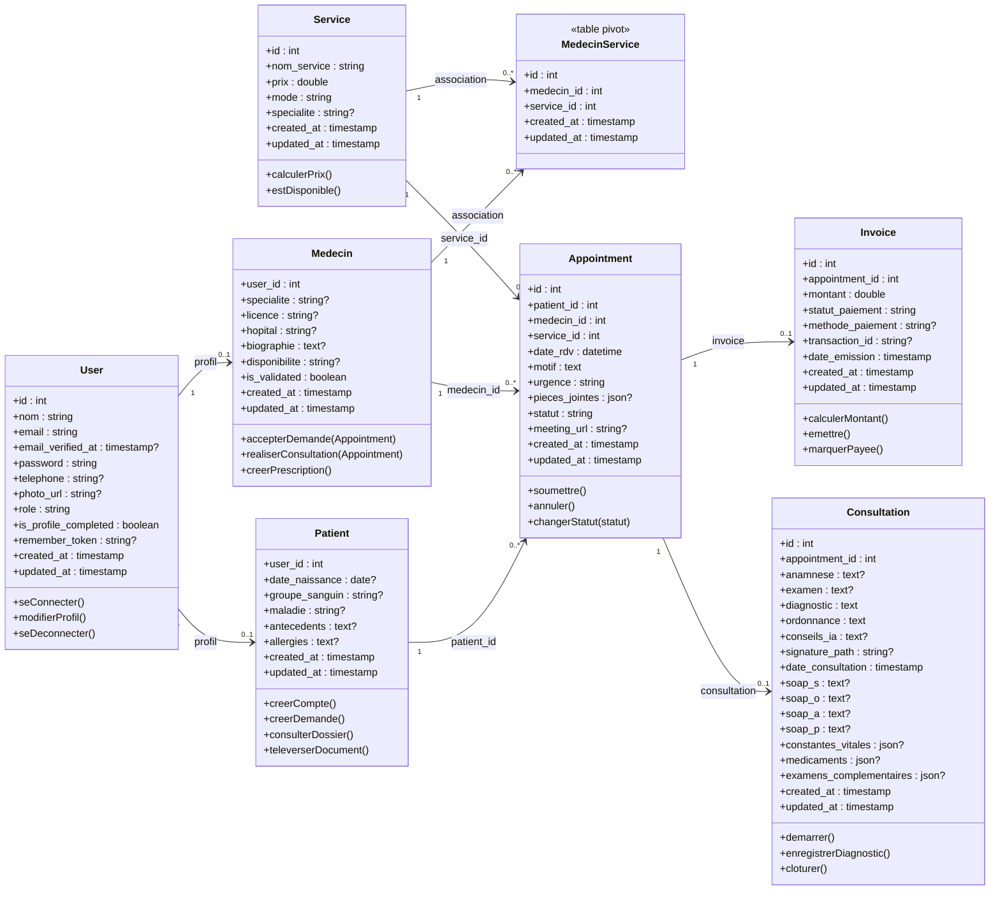

# Diagramme de classes du système

Ce diagramme représente les entités et les relations telles qu'elles sont implémentées dans les modèles et les migrations Laravel. Les noms de classes, attributs et opérations correspondent au code. Aucune table ni migration n'est modifiée.



## Description du diagramme et des multiplicités

Le diagramme de classes présente les principales données du système de santé et la façon dont elles sont liées. La classe `User` représente le compte utilisé pour accéder à l’application. Un compte peut être associé à un profil `Patient` ou à un profil `Medecin`, et chaque profil est rattaché à un seul compte. Il s’agit d’associations entre les classes, et non d’un héritage.

La classe `Patient` représente la personne qui recherche un médecin et demande un rendez-vous. Après avoir consulté les médecins et les services proposés, le patient choisit le médecin, le service, une date et une heure, puis indique le motif de sa demande. Un patient peut soumettre zéro ou plusieurs rendez-vous, tandis que chaque rendez-vous est rattaché à un seul patient. Cette relation est représentée par la multiplicité `1` à `0..*`.

La classe `Medecin` représente le profil professionnel du médecin. Un médecin peut recevoir zéro ou plusieurs rendez-vous, et chaque rendez-vous concerne un seul médecin : la relation entre `Medecin` et `Appointment` a également la multiplicité `1` à `0..*`. Le médecin peut proposer plusieurs services, et un même service peut être proposé par plusieurs médecins. Cette relation plusieurs-à-plusieurs est matérialisée par `MedecinService`, qui correspond à la table pivot `medecin_service`.

La classe `Service` décrit la prestation choisie, notamment son nom, son prix et son mode. Un rendez-vous référence un seul service, alors qu’un service peut être associé à zéro ou plusieurs rendez-vous. La relation entre `Service` et `Appointment` a donc la multiplicité `1` à `0..*`.

La classe `Appointment` représente la demande et le rendez-vous lui-même. Lors de l’envoi de la demande, le système crée le rendez-vous avec le statut `En_attente` et génère une facture non payée dont le montant correspond au prix du service choisi. Le médecin accepte la demande, qui passe au statut `Accepte`, ou la refuse, auquel cas le statut devient `Annule`. La facture ne peut être payée qu’après l’acceptation. Une fois le paiement enregistré, la facture passe à `Paye` et le rendez-vous à `Confirme`.

La classe `Invoice` représente cette facture. Chaque facture est liée à un seul rendez-vous et, selon les relations déclarées dans les modèles, un rendez-vous est associé à zéro ou une facture : la multiplicité est `1` à `0..1`. De même, la classe `Consultation` représente les informations médicales enregistrées par le médecin. Elle est liée à un seul rendez-vous; un rendez-vous peut ne pas encore avoir de consultation ou en avoir une seule, soit la multiplicité `1` à `0..1`. La consultation est enregistrée pour un rendez-vous confirmé, puis le rendez-vous passe au statut `Termine`. La facture et la consultation sont toutes deux rattachées au rendez-vous par `appointment_id`; elles ne sont pas liées directement entre elles.

Après la consultation, le patient peut consulter les informations médicales enregistrées dans son dossier. Ce dossier est constitué des consultations associées à ses rendez-vous; le système ne possède pas de classe ou de table distincte `DossierMedical`. De même, la spécialité est enregistrée comme un attribut texte et ne constitue pas une classe séparée.

Les multiplicités indiquent le nombre d’objets pouvant être associés : `1` signifie un seul, `0..1` signifie aucun ou un, et `0..*` signifie aucun, un ou plusieurs. Les multiplicités `0..1` de la facture et de la consultation correspondent aux relations `HasOne` déclarées dans les modèles Laravel. Les migrations ne posent toutefois pas de contrainte `UNIQUE` sur `appointment_id`; la base de données n’impose donc pas à elle seule cette limite.

## Exporter le diagramme en image

1. Copie uniquement le contenu du bloc Mermaid, de `classDiagram` jusqu'à la dernière association `Appointment "1" --> "0..1" Consultation : consultation`. Ne copie pas les balises Markdown `` ```mermaid `` et `` ``` ``.
2. Ouvre [Mermaid Live Editor](https://mermaid.live) et colle le code dans le panneau d'édition.
3. Vérifie le rendu, puis clique sur **Actions** ou **Export** et choisis **PNG**.
4. Enregistre le PNG sur ton ordinateur.

Mermaid dessine les relations et multiplicités écrites dans le bloc. Par exemple, `Patient "1" --> "0..*" Appointment` affiche un patient associé à zéro ou plusieurs rendez-vous; elles ne sont pas déduites automatiquement.
